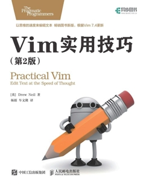

 GOD OF EDITOR [VIM][0]
=================

<!--  -->

**To make good work, to make sharp tools!  
Hello, welcome to the god of editor VIM !**

#### This is a vim setting through `.vimrc` for most useful skills with the traditional faster way
- [x] [Window control](#window-control)
- [x] Blinking cursor insert mode
- [x] Binary cursor move
- [x] Cursor move insert mode
- [x] Case conversion insert mode
- [x] System clipboard for yank
- [x] Fast `lcd`
- [x] Fast fold
- [x] Hex format
- [x] Document format
- [x] Section jump: [[、]]、[]、][
- [x] Async command for anny
- [x] Custom schedule window
- [x] Grep
- [x] ctags
- [x] cscope
- [x] Macro for log
- [x] Code comments
- [x] Git tool
- [x] Highlight cpp
- [x] Preview markdown
- [x] Translator
- [x] [LSP](#lsp)
- [ ] Make
- [x] Vim9

#### Quick Start

**Install vim**

Recommend compile source code
- `sudo apt install libwayland-dev`
- `git clone https://github.com/vim/vim.git`
- `cd vim`
- `./configure --prefix=/usr/local --with-features=huge`
- `make -j8`
- `sudo make install`
> note: Install build tools first and `libwayland-dev` is very imported for clipboard support

**Config vim**
1. clone [vim-plug][1] for vim plugin manager  
`curl -fLo ~/.vim/autoload/plug.vim --create-dirs https://raw.githubusercontent.com/junegunn/vim-plug/master/plug.vim`
2. add your vim settings to `.vimrc` and copy it to  
`cp .vimrc ~/`
3. open your vim and run this command for plugin install  
`:PlugInstall`

#### Window control

**base skills**
* `<C-w> s`: split window horizontal
* `<C-w> v`: split window vertical
* `<C-w> k`: move cursor to above window
* `<C-w> j`: move cursor to below window
* `<C-w> h`: move cursor to left window
* `<C-w> l`: move cursor to right window
* `<C-w> t`: move cursor to top-left window
* `<C-w> b`: move cursor to bottom-right window
* `<C-w> p`: move cursor to last accessed window
* `<C-w> K`: move window to very top, make full with
* `<C-w> J`: move window to very bottom, make full with
* `<C-w> H`: move window to far left, make full height
* `<C-w> L`: move window to far right, make full height
* `<C-w> T`: move window to a new tab page
* `<C-w> _`: max window vertical
* `<C-w> |`: max window horizontal
* `<C-w> =`: equal all windows
* `<C-w> o`: close all windows except current one
* `<C-w> c`: close current window, last one fails
* `<C-w> q`: quit current window, last one exit vim

**custom skills**
* `\o` : max window size
* `\x` : min window horizontal
* `\X` : min window vertical
* `<S-Up>`   : window size +1 horizontal
* `<S-Down>` : window size -1 horizontal
* `<S-Left>` : window size -1 vertical
* `<S-Right>`: window size +1 vertical

> note: `\` is a `<leader>` of vim by default

> ugly: `let mapleader=";"` conflict with `f;`

#### LSP

语言服务协议LSP默认使用[vim-lsp][2]支持

#### Best way to learn vim

* 《Vim实用技巧 第二版》  

* 《[Learn Vimscript the Hard Way][3]》

[0]: <https://www.vim.org>
[1]: <https://github.com/junegunn/vim-plug>
[2]: <https://github.com/prabirshrestha/vim-lsp>
[3]: <https://learnvimscriptthehardway.stevelosh.com>
